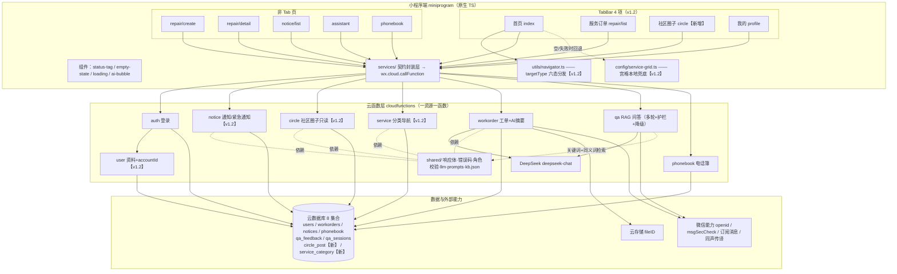
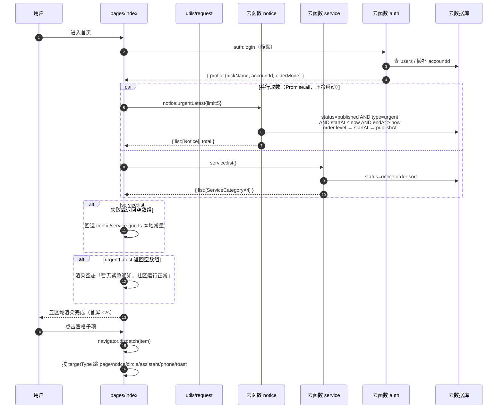
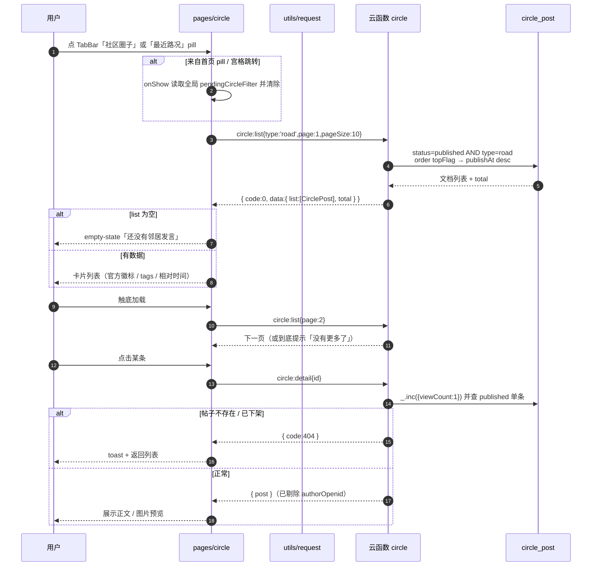
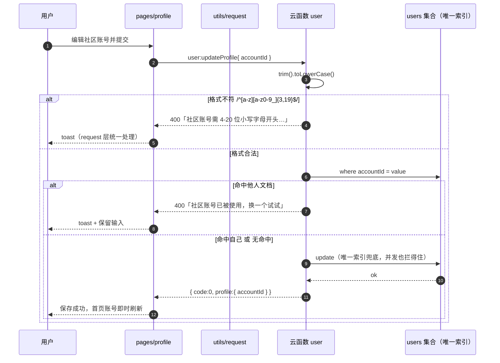
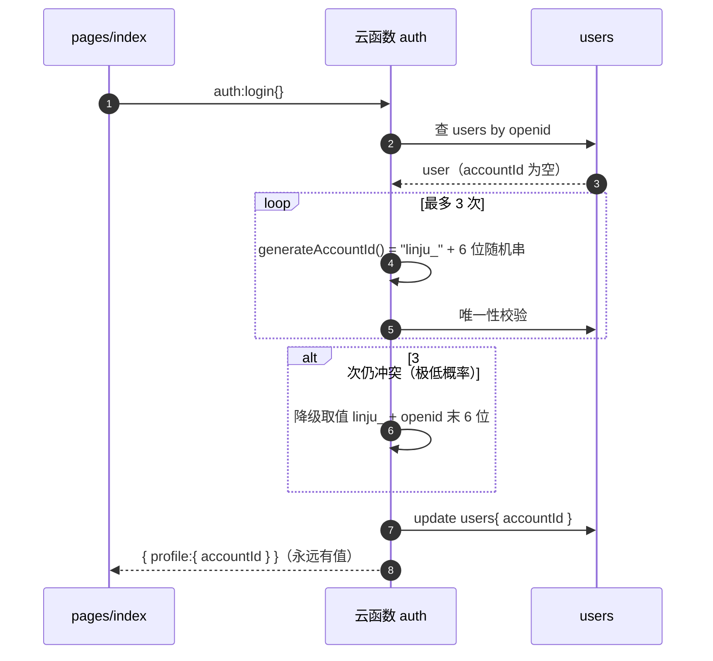
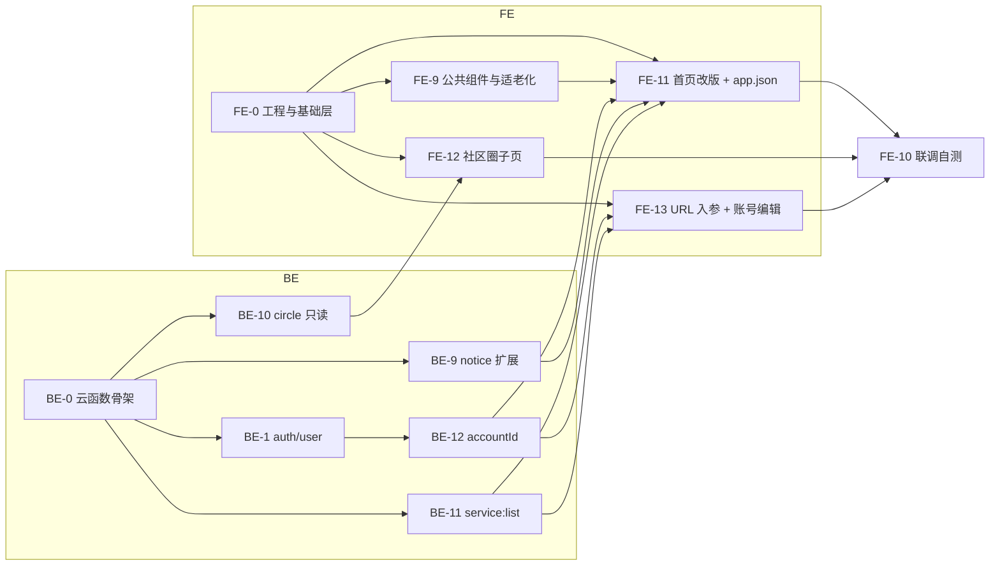

# 社区便民微信小程序 · 架构设计

> 作者：架构师｜版本：**v1.2**｜日期：2026-10-13｜状态：**待 G4 用户确认**
> 上游：`docs/02-产品方案PRD.md`（P0/P1/P2 范围，权威）、`docs/03-设计预览表.md` v1.1（G3 已通过）、`docs/03-design-tokens.md` v1.1（清新绿）、`docs/01-项目拆解方案.md`（含变更 C1）
> 下游：`contracts/api-contract.md` v1.2、`contracts/db-schema.md` v1.2、`contracts/task-cards.md` v1.2、`contracts/契约变更记录.md`
>
> **核心约束**：距提交 **12 天**（2026-10-25 23:59）。本文件的所有技术决策都以「**可被 2 名学生在 6 天内实现**」为前提；任何需要新增页面 / 引入重框架 / 依赖外部账号的方案，一律否决或降级。

---

## 1. 实现路径（技术选型）

### 1.1 已冻结的选型（不做变更）

| 维度 | 选型 | 理由 | 来源 |
| --- | --- | --- | --- |
| 平台 | 微信小程序原生（TS） | AppID `wx6af52092db32a671`；已落地，切换成本远大于收益 | `project.config.json` |
| 后端 | 微信云开发（云函数 + 云数据库 + 云存储） | 免服务器免备案、评审易验收、微信生态加分 | `docs/01` §0 |
| 数据库 | 云开发文档型 NoSQL（8 集合） | 与云服务同源，无连接管理成本；读写全走云函数 | `contracts/db-schema.md` |
| 大模型 | DeepSeek `deepseek-chat` | 中文好、成本低（<2 元/200 次演示）；AI 融合 20% 评分主动脉 | `04-架构师规范` §7.7 |
| 云函数运行时 | `Nodejs18.15` | 本机 Node 24 无全局 `fetch`，统一 `axios`；避免云端 API 缺失 | `04-架构师规范` §4.7 |
| UI 组件 | 自绘轻量组件，**不引入 Vant/TDesign** | 适老化需深度定制 + 省包体积（预算 2MB） | `docs/03-design-tokens.md` §⑨ |
| 请求层 | 统一 `utils/request.ts` 封装，**不引入全局状态库** | 8 页面规模，页面级 data 足够 | — |

### 1.2 v1.2 新增决策（本轮重点）

| # | 决策点 | 备选方案 | **定稿选择** | 决策理由 | 工期对比 |
| --- | --- | --- | --- | --- | --- |
| D-A | 首页紧急数据源 | ①新集合 `urgent_notice` ②复用 `notice` 加 `type=urgent` | **② 复用 notice** | 零新增集合、零新增安全防护、复用既有发布与审核链路；老数据无需迁移 | ②0.5 天 vs ①1.5 天 |
| D-B | 紧急区取数接口 | ①`notice:list` 加 filter ②新增 `notice:urgentLatest` | **② 新增专用接口**（内置降级通道①） | 职责分离 + 省一次前端过滤 + 支持 `level` 复合排序；工期增量仅 0.5 天 | ②0.5 天 vs ①0.2 天（但损失排序与生效判定） |
| D-C | 社区圈子范围 | ①完整 UGC（发帖/评论/点赞）②只读数据流 | **② 只读数据流**（发帖/评论列 P2） | UGC 需 `msgSecCheck` + 图片审核 + 举报机制，PRD P0 也不含；12 天不允许 | ②0.5 天 vs ①+2~3 天 |
| D-D | 四类服务宫格承接 | ①新建 4 个页面 ②聚合接口 + targetType 路由复用现有页 | **② 聚合接口 `service:list`**（0 新增页面） | 8 个子项全部落到现有页面/能力且真实可达，其中 4 项喂 AI 助手；降级可退化为前端本地常量 | ②1.0 天 vs ①+2.5~3 天；再降级 0.3 天 |
| D-E | 「用户注册的微信号」 | ①坚持显示 ②改社区账号可编辑 | **② 社区账号 `accountId`** | 微信未开放该字段（技术不可实现），用户已批准改为社区账号 | ②0.25 天 vs ①不可实现 |
| D-F | TabBar 与 AI 入口冲突 | — | AI 助手移出 Tab，但**首页保留 ≥3 个入口** | AI 占 20% 评分，入口不得消失 | 0（并入 FE-11） |

### 1.3 明确否决项（防回归）

- ❌ **uni-app / Taro**：项目已用原生 TS 起步，切换等于重写，工期不允许。
- ❌ **自建 Node/Java 后端 + 云服务器**：需备案 + 域名 + 运维，赛期不可行。
- ❌ **SSE 流式返回**：云函数原生不支持 SSE，URL 化需域名与额外改造；改用「非流式 + 前端打字机模拟」。
- ❌ **embedding 向量检索 / 外部工作流平台（Coze/Dify）**：DeepSeek 无 embedding 接口，外部平台是 12 天工期的风险源；用免费的关键词 + 同义词打分。
- ❌ **地图 / ECharts 图表**：需申请 Key + 增加包体积，P0 不做。
- ❌ **社区圈子 UGC、MCP 工具调用、微信支付**：P2 or Out，见 `docs/01` §2。

---

## 2. 目录规范（脚手架实际结构）

```
community-miniprogram/
├── project.config.json          # appid wx6af52092db32a671、miniprogramRoot、cloudfunctionRoot
├── README.md                    # 云环境 ID、启动步骤、测试账号（不含任何密钥）
├── .gitignore                   # node_modules/ .env ci.key
├── miniprogram/                 # 前端
│   ├── app.json                 # ⚠ v1.2：TabBar 4 项 + pages/circle/index（由前端按契约附 A 落地）
│   ├── app.ts / app.wxss        # 入口 + Design Token v1.1 变量块
│   ├── pages/
│   │   ├── index/               # 首页（Tab·v1.2 改版五区域）
│   │   ├── repair/{create,list,detail}/   # 报修创建 / **服务订单（Tab）** / 详情
│   │   ├── circle/              # 【v1.2 新增】社区圈子（Tab）
│   │   ├── notice/list/         # 通知·活动列表（v1.2 支持 ?type=&tag=）
│   │   ├── assistant/           # AI 助手（已移出 Tab，保留路由 + ‹ 返回）
│   │   ├── phonebook/           # 便民电话簿（v1.2 支持 ?category=）
│   │   └── profile/             # 我的（v1.2 新增社区账号编辑项）
│   ├── components/{status-tag,empty-state,loading,ai-bubble}/
│   ├── config/                  # env.ts + 【v1.2】service-grid.ts（宫格本地兜底常量）
│   ├── services/                # 契约封装层（每云函数一个文件：notice.ts / circle.ts / service.ts …）
│   ├── utils/                   # request / storage / format / pagination / 【v1.2】navigator（targetType 分发）
│   ├── viewmodels/ / store/     # 页面级数据与轻量全局态
│   ├── mock/                    # 后端未就绪时的开关式 mock
│   ├── typings/                 # model.d.ts / api.d.ts（与契约 TS 接口一一对应）
│   └── static/ assets/icons/    # 图标：TabBar 4 组双态 + 宫格 4 组 + 装饰 2 组
├── cloudfunctions/
│   ├── shared/                  # 公共：response（统一响应体）/ errors / auth（角色校验）/ llm / prompts / kb/kb.json
│   ├── auth/ user/ workorder/ notice/ circle/【v1.2】service/ qa/ phonebook/
│   │   └── 每函数：index.js + package.json + config.json（timeout：AI 类 60s，其余 20s）
├── contracts/                   # api-contract.md / db-schema.md / task-cards.md / 契约变更记录.md / 联调问题清单.md
├── docs/                        # 全角色文档（01~16）+ backup/
├── scripts/                     # seed.mjs（种子数据）/ kb.mjs / upload.js
└── test/                        # 接口冒烟脚本
```

**硬规则**：① 前端**只允许**通过 `services/` 层调用契约内接口，页面严禁裸调 `wx.cloud.callFunction`；② 集合**任何人不可直读**，全部走云函数；③ 新增页面不得挂 TabBar（TabBar 锁 4 项）。

---

## 3. 系统架构图



---

## 4. 数据模型（classDiagram）

```mermaid
classDiagram
  class User {
    +string _id
    +string _openid
    +string nickName
    +string phoneMask
    +string accountId
    +string role
    +string building
    +boolean elderMode
  }
  class Notice {
    +string _id
    +string title
    +string content
    +string type
    +string status
    +string publishAt
    +string location
    +string level
    +string startAt
    +string endAt
    +string summary
    +isActiveNow() bool
  }
  class CirclePost {
    +string _id
    +string title
    +string content
    +string type
    +string[] tags
    +string authorName
    +string authorRole
    +string[] images
    +string sourceType
    +string status
    +boolean topFlag
    +number viewCount
    +string publishAt
  }
  class ServiceCategory {
    +string key
    +string title
    +string subtitle
    +string icon
    +string iconTheme
    +number sort
    +string status
    +ServiceItem[] items
  }
  class ServiceItem {
    +string key
    +string name
    +string targetType
    +string targetPath
    +Record targetParams
    +string tip
    +number sort
  }
  class WorkOrder {
    +string _id
    +string category
    +string status
    +string aiSummary
    +string[] images
  }
  class NoticeService {
    +list(type, includeExpired, page) Result
    +urgentLatest(limit) Notice[]
    +detail(id) Notice
  }
  class CircleService {
    +list(type, tag, keyword, page) CirclePost[]
    +detail(id) CirclePost
  }
  class ServiceCatalogService {
    +list(key) ServiceCategory[]
  }
  class UserService {
    +updateProfile(nickName, phone, building, elderMode, accountId) User
    +generateAccountId() string
    +lazyMigrateAccountId() string
  }
  class RequestLayer {
    +call(name, action, payload) Result
    +onCodeNonZero(code, msg) void
  }
  class NavigatorUtil {
    +dispatch(ServiceItem) void
  }

  ServiceCategory "1" *-- "n" ServiceItem : 内嵌 items
  UserService ..> User : 读写
  NoticeService ..> Notice : 读写
  CircleService ..> CirclePost : 只读
  ServiceCatalogService ..> ServiceCategory : 只读
  RequestLayer --> NoticeService : notice:*
  RequestLayer --> CircleService : circle:*
  RequestLayer --> ServiceCatalogService : service:list
  RequestLayer --> UserService : user:*
  NavigatorUtil ..> ServiceItem : 消费 targetType
  Notice "1" <.. "0..1" CirclePost : sourceType=sync 镜像
```

---

## 5. 关键调用流（sequenceDiagram）

### 5.1 首页首屏加载（v1.2 五区域）



### 5.2 社区圈子列表（只读流）



### 5.3 社区账号更新与唯一性校验



### 5.4 懒迁移（老用户 accountId 为空）



---

## 6. 错误码表（引用）

> **唯一来源：`contracts/api-contract.md` 抬头错误码表。** 本文件不另设码表，避免两套码并存导致前后端漏判（CR-003 已踩过此坑）。

| code | 含义 | 前端动作 |
| --- | --- | --- |
| 0 | 成功 | — |
| 400 | 参数错误 / 内容审核未过 / 幂等冲突 / **账号被占用或格式非法（v1.2）** | toast `msg` 原文 |
| 401 | 未登录 / 登录态失效 | 触发静默登录后重试 |
| 403 | 无权限（角色不足 / 越权访问他人工单） | toast「无权限」并隐藏入口 |
| 404 | 资源不存在（**仅单条查询接口**） | toast + 返回列表页 |
| 429 | 请求过于频繁 | toast，稍后重试 |
| 500 | 服务内部错误 | 统一兜底话术 |
| 503 | AI 服务暂时不可用（已降级） | 展示降级话术 + 电话簿 Top3 |

**v1.2 硬规则**：① **不新增任何错误码**；② `list` 类接口空数据一律 `{code:0, list:[], total:0}`，**禁止用 404 表示"没数据"**；③ 新增接口的码表归属见 `api-contract.md` 附 B。

---

## 7. 权限与安全

| 项 | 策略 |
| --- | --- |
| 身份 | `openid` 只从云函数 `cloud.getWXContext()` 取，**前端传 openid 一律忽略**（防伪造） |
| 角色 | `resident` / `property` / `admin`，写操作在云函数侧按矩阵校验 |
| 数据库权限 | 全部集合「所有用户不可读写」，读写**仅走云函数** |
| 手机号 | AES 加密存储，展示脱敏 `138****1234` |
| UGC 内容安全 | 工单描述等 UGC 接 `security.msgSecCheck` 先审后发；**圈子本期无 UGC，不需审核** |
| 隐私字段 | `circle_post.authorOpenid` 只入库**不下发**；`qa_sessions.turns` 管理员只读聚合不可读原文 |
| 密钥 | `DEEPSEEK_API_KEY` 等全部放云函数环境变量，代码与文档**零明文**；提交前 grep `sk-` 扫描 |
| 合规 | 首登《隐私政策》弹窗 + 「我的」页可查；AI 回答固定注入「AI 生成仅供参考」 |

---

## 8. AI 方案（引用 + 调用链）

> 详细规格（`qa:ask` 多轮会话、双层护栏、未命中阈值、Prompt 版本、Eval）由 **AI 工程师** 维护，权威文档为 `09-AI工程师-skill.md` 与 `api-contract.md` §qa。架构师保留**调用链与超时预算**决策权。

**调用链**：小程序 → 云函数 → 输入护栏 → 知识库检索（`cloudfunctions/shared/kb/kb.json`）→ DeepSeek → 输出护栏 → 日志入库（`cost_ms` 可导出）→ 返回；失败降级。

**超时预算**：云函数 `timeout=60s`；HTTP 调 DeepSeek `timeout=8000ms`。
**降级链路**：LLM 失败 → 返回命中文档摘要 + 电话簿 Top3 + 「可拨打人工电话」，`degraded=true`，**HTTP code 仍为 0**（业务成功，不断流）。
**v1.2 新增的 AI 落点**：四类服务宫格中 **4 个子项**跳 AI 助手并预填提问（疫苗档案 / 上门陪护 / 适老化改造 / 健康报告）→ 直接扩充 AI 融合 20% 评分的演示素材。

---

## 9. 依赖与实现顺序

### 9.1 依赖图（v1.2 增量）



### 9.2 实现顺序（推荐）

| 序 | 动作 | 谁 | 为什么排这个序 |
| --- | --- | --- | --- |
| 1 | BE-12 `accountId`（0.25 天） | 后端 | FE-11/FE-13 都依赖；无依赖、最小闭环 |
| 2 | FE-12 圈子页**空壳**（先建 `pages/circle/index`） | 前端 | 解锁 app.json TabBar 配置，避免编译报错 |
| 3 | BE-10 circle（0.5 天） | 后端 | 圈子 Tab 的数据源，与 1 并行 |
| 4 | BE-9 notice 扩展（0.5 天） | 后端 | 首页紧急区数据源，与 1/3 并行 |
| 5 | BE-11 service:list（0.5 天） | 后端 | 与前三张全并行；工期告急时**第一顺位砍** |
| 6 | FE-13 URL 入参改造（0.5 天） | 前端 | 宫格承接的前置，先于 FE-11 完成可独立验证 |
| 7 | FE-11 首页改版 + app.json（1.0 天） | 前端 | 依赖 1/4/5，工作量最大，放到最后 |
| 8 | FE-12 圈子页内容（0.5 天） | 前端 | 与 6/7 并行 |
| 9 | 联调 + 重跑种子 | 双方 | 确认紧急通知未过期、圈子页非空 |

### 9.3 已冻结的既有实现顺序

BE-1 → BE-2 → BE-3（工单状态机）；BE-4/BE-5/BE-6/BE-7 可并行；FE-9 是所有 FE 页的前置；FE-10 最后联调。**v1.2 增量卡全部与该链路松耦合，可叠加并行。**

---

## 10. 性能预算与验收

| 指标 | 目标 | 落地手段 |
| --- | --- | --- |
| 首页首屏 | ≤2s | 首屏仅 2 次云函数调用（`urgentLatest` + `service:list`），用 `Promise.all` 并发；骨架屏过渡冷启动 |
| 主包体积 | ≤1.5MB（总 ≤2MB） | 不引第三方 UI 库；图标本地 PNG ≤81px；`lazyCodeLoading: requiredComponents` |
| 列表 | 分页 pageSize 默认 10 上限 50 | 触底加载；图片懒加载 + 前端压缩至 80% 质量 ≤2MB |
| 五态 | 每个区域必须有 默认/空/加载/错误/断网 | 宫格为静态渲染，不设错误态（设计预览 §5 允许） |
| 适老化 | 1.25× 字号重排，**禁用整页 scale** | `.care-mode` 根节点变量覆盖；宫格 2×2 → 1 列 4 行 |

---

## 11. 风险清单（架构侧）

| # | 风险 | 概率 | 影响 | 应对 | 负责 |
| --- | --- | --- | --- | --- | --- |
| R-A | v1.2 增量 +1.0~1.25 天吞掉缓冲，M5（10-19）失守 | 中 | 高 | 已列**降级优先级**（先砍 BE-11，再砍圈子详情页、账号编辑、urgentLatest）；10-19 当日决策 | PM + 架构师 |
| R-B | 紧急通知种子写死日期 → 演示当天已过期 → 紧急区空态 | **高** | 高 | 契约强制「种子日期**相对生成**（`now+Nd`）」；10-23 打包前**必须重跑种子** | 后端 + 运维 |
| R-C | `pages/circle/index` 未建先配 TabBar → 编译报错 | 中 | 中 | 落地顺序约束（先建空壳页再改 app.json），已写入 FE-12 与契约附 A | 前端 |
| R-D | `service:list` 失败导致首页宫格白屏 | 中 | 高 | 前端**必须**内置本地兜底常量；后端异常时仍返 `{code:0,list:[]}` 不返 500 | 前端 + 后端 |
| R-E | `accountId` 并发撞号 | 低 | 中 | **数据库唯一索引**（硬约束）+ 应用层友好报错，二者缺一不可 | 后端 |
| R-F | 首页负边距把通知卡顶部裁切 | 中 | 中 | 头部与内容必须在**同一滚动容器**内再做负边距（设计预览 v1.2 修复项） | 前端 |
| R-G | 冷启动导致首屏 >2s | 中 | 中 | 首页调用合并 + 骨架屏；不在首屏引入 AI 调用 | 前端 + 后端 |
| R-H | 密钥明文进提交包 → 违规 | 低 | 极高 | 环境变量 + `.gitignore` + 提交前 `grep -r "sk-"` 扫描 | 后端 + 运维 |
| R-I | 圈子页无 UGC 被评委质疑"做不了闭环" | 中 | 低 | 答辩口径明确：P0 走「官方发布 + 居民查看」的公告流闭环，UGC 已规划为二期 | PM |

---

## 12. 待明确事项（需产品/用户拍板，不阻塞开工）

| # | 事项 | 架构师建议 | 未拍板即执行的默认值 |
| --- | --- | --- | --- |
| U-1 | 社区圈子是否支持用户发帖/评论 | **维持 P2 不做**（+2~3 天） | 只读数据流 |
| U-2 | 紧急通知是否推送订阅消息 | P2；模板 ID 需后台申请 | 暂不做，仅列表展示 |
| U-3 | `accountId` 是否限制修改频率 | P2 限频 | P0 不限次数，仅做格式 + 唯一校验 |
| U-4 | 「每周义诊 / 健康报告」真实数据源 | 复用 `notice?type=activity` + AI 预填提问 | 按契约承接表 |
| U-5 | `service_category` 文案冻结时点 | 建议 10-24 冻结 | 由 PM 排期确认 |
| U-6 | 「服务订单」后续是否并入缴费/团购订单 | 保持 `workorder:list` 单源 | 本期只含报修工单 |
| U-7 | 云开发环境（dev）是否全队共用 | 全队共用同一环境，环境 ID 写入 README | 按 `docs/00-环境与资源速查.md` 现状执行 |

---

## 13. 参赛材料可用素材（本文件产出）

| 材料 | 位置 | 用于 |
| --- | --- | --- |
| 系统架构图（PNG 可导出） | §3 Mermaid flowchart | 作品说明文档「技术实现」25% |
| 数据模型类图 | §4 classDiagram | 说明"契约驱动 + 分层设计" |
| 关键调用时序图 ×4 | §5 sequenceDiagram | 说明 AI 融合与边界处理 |
| 技术选型对比与理由 | §1.1 / §1.2 / §1.3 | 「材料完整性」10% |
| 错误码单源 + 权限矩阵 | §6 / §7 | 说明工程严谨性 |
| 性能预算表 | §10 | 「产品体验」10% |
| 风险登记表 | §11 | 答辩 Q&A 预案 |

---

## 14. 参考来源

| 结论 | 来源 | 查询日 |
| --- | --- | --- |
| `wx.login` / `getUserInfo` 均不返回用户注册的微信号，`wx.getUserProfile` 已废弃 → 首页「社区账号」替代方案的根因 | `developers.weixin.qq.com/miniprogram/dev/api/open-api/login/wx.login.html` | 2026-10-13 |
| TabBar `list` 最少 2 最多 5 项、`pagePath` 必须在 `pages` 中且不能是 Tab 页参数传递限制 | `developers.weixin.qq.com/miniprogram/dev/framework/config/app.html` | 2026-10-13 |
| 云函数运行时（Nodejs16.13/18.15）与 timeout 设置 | `docs.cloudbase.net` / `developers.weixin.qq.com/miniprogram/dev/wxcloud/` | 2026-10-13 |
| DeepSeek `chat/completions` 请求体与 `response_format` | `api-docs.deepseek.com` | 2026-10-13 |

---

## 15. 自检清单（对照 `04-架构师规范` §14）

| # | 项 | 状态 |
| --- | --- | :-: |
| 1 | 已读 PRD / 设计预览 v1.1 / Design Token v1.1 / 拆解方案 / 契约 v1.1 / app.json 全部输入 | ✅ |
| 2 | 技术选型有对比 + 理由 + 来源 | ✅ §1 |
| 3 | 系统架构图 Mermaid 语法正确（flowchart / classDiagram / sequenceDiagram / graph 四张） | ✅ |
| 4 | 目录规范与实际脚手架一致 | ✅ §2（已核对 miniprogram/ 与 cloudfunctions/ 实际目录） |
| 5 | 错误码表唯一、引用契约未另立炉灶 | ✅ §6 |
| 6 | 8 集合字段/索引/权限齐全 | ✅（见 `contracts/db-schema.md` v1.2） |
| 7 | 任务卡每张含负责人/分支/工期/依赖/验收 | ✅（FE-11~13、BE-9~12 已补） |
| 8 | 契约变更全量登记 CR-005~CR-010 | ✅ |
| 9 | 向后兼容：只增不删不改语义，已逐条声明 | ✅ |
| 10 | 每项提议标了工期成本与降级替代 | ✅ §1.2 / task-cards 降级优先级 |
| 11 | 密钥零明文（本文件 grep 无 `sk-`） | ✅ |
| 12 | 风险清单覆盖 v1.2 增量引入的新风险 | ✅ §11 |
| 13 | 待明确事项已列出并给默认值 | ✅ §12 |
| 14 | 范围不蔓延（圈子 P2 发帖、0 新页面、0 新错误码） | ✅ |
| 15 | G4 用户确认记录归档 | ⬜ 待用户确认后补 |
| 16 | FE/BE 移交消息已发送 | ⬜ 待 G4 通过后执行 |
