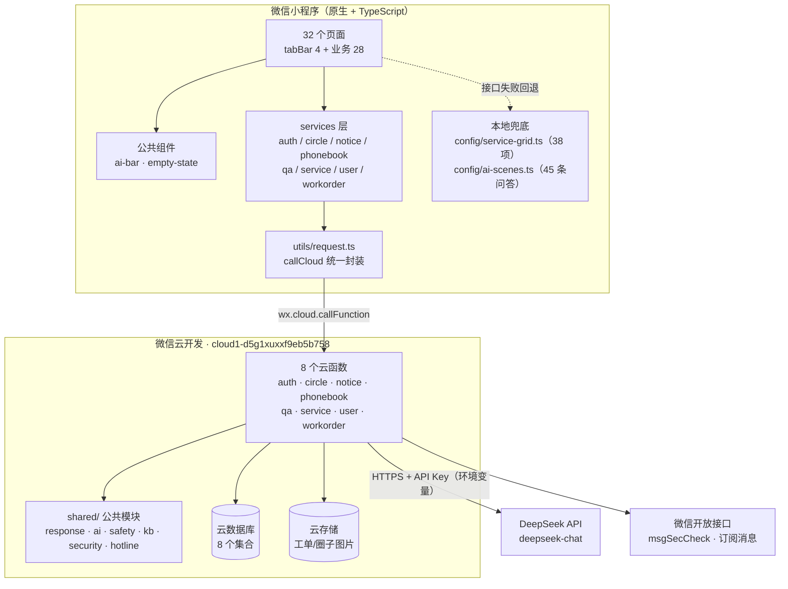
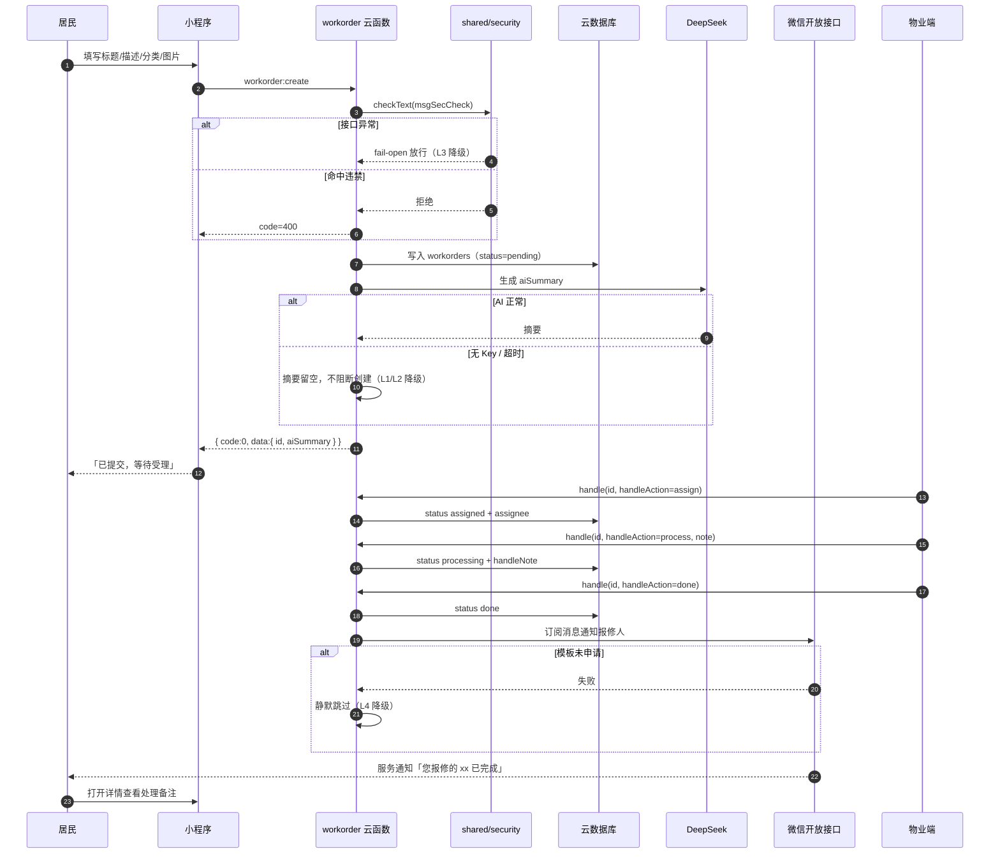
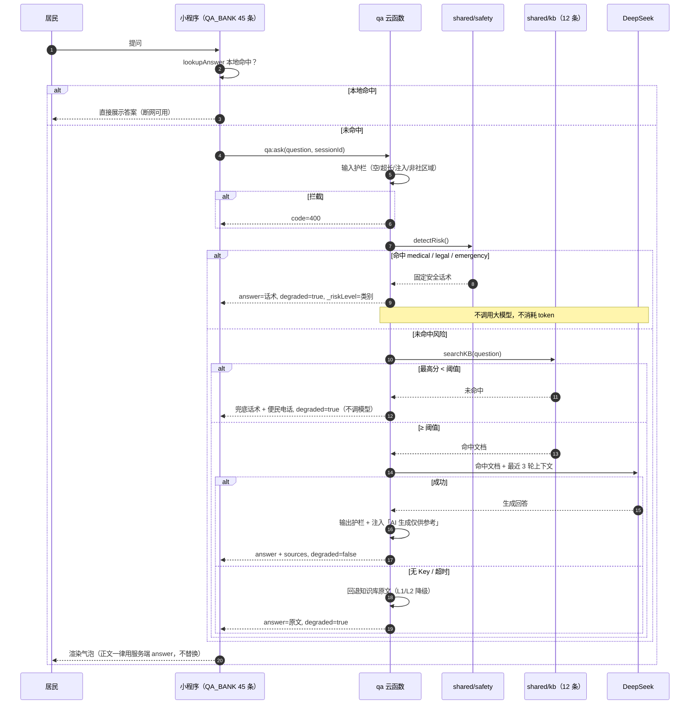

# 程序设计说明书 v1.0

**项目**：社区便民小程序（邻里小助手）
**赛事**：讯方杯 · 提交截止 2026-10-25 23:59 · 答辩 2026-10-27
**代码基线**：`main@50ff2bb`｜产品版本 **v1.1.0**｜契约版本 v1.4
**规模**：32 个页面 · 8 个云函数 · 19 个对外动作 · 8 个数据库集合 · 310 条自动化测试
**文档日期**：2026-10-20

> 本文所有数据均来自当前代码与契约文件（`contracts/`、`cloudfunctions/`、`miniprogram/`），
> 不包含未实现的设计设想。凡「尚未完成」的地方，§9.5 与附录 A 如实标注。

---

## 1 项目概述

### 1.1 目标用户

| 用户群 | 画像 | 核心诉求 |
|---|---|---|
| **社区居民（主力）** | 25–70 岁，含大量不熟悉 App 操作的中老年人 | 一件事只跑一趟：报修、缴费、挂号、办事指南、找电话 |
| **独居老人 / 行动不便者** | 60 岁以上，视力与操作能力下降 | 大字、少层级、能一键打电话给人 |
| **物业维修人员** | 现场作业，手机操作为主 | 快速接单、看清单据、回报进度 |
| **社区居委会 / 管理员** | 兼职管理，非技术人员 | 发通知、看统计、改服务分类（不改代码） |

### 1.2 社区场景

一个典型的城市社区，居民日常面对的事务高度集中在**五类**：
生活报修（水电门禁公共设施）、政务办事（居住证/高龄补贴/社保）、健康（疫苗/体检/慢病/家庭医生）、
邻里互助（闲置/拼单/路况/失物）、紧急求助（停水停电/安全隐患/医疗急症）。

这些事务的共同特征是：**频次高、单次价值低、信息分散在物业群/公告栏/电话簿/政府网站四处**。
居民的真实成本不在"办"，而在"**找不到入口、问不到人、跑冤枉路**"。

### 1.3 痛点与解法

| # | 痛点 | 现状 | 本项目的解法 | 实现位置 |
|---|---|---|---|---|
| P1 | 不知道找谁 | 电话簿贴在公告栏，老人在家看不到 | 便民电话簿 + 紧急求助三宫格（110/119/120 一键拨号） | `pages/phonebook` |
| P2 | 报修没回音 | 微信群里喊一句，被刷屏淹没 | 工单闭环：提交 → 派单 → 处理中 → 完成，每步可查，完成时订阅消息通知 | `pages/repair/*` + `workorder` 云函数 |
| P3 | 办事不知道带什么材料 | 跑一趟才发现缺证件 | 办事指南卡（材料/流程/窗口/时限/常见退回） | `pages/service/guide` |
| P4 | 老人不会用 | 字小、层级深、按钮密 | 关怀模式：字号 ×1.25 且**触发重排**（宫格 2 列→1 列），非整页缩放 | `.care-mode` + `profile` |
| P5 | 问不到人 | 物业下班后无人应答 | AI 问答：本地 45 条 + 云端知识库 + DeepSeek，**断网也有答案** | `pages/assistant` + `qa` 云函数 |
| P6 | AI 会胡说 | 通用大模型对医疗/法律给出错误建议 | **高风险前置拦截**：涉医/涉法/紧急求助不走模型，直接返回固定安全话术 | `shared/safety.js` |

### 1.4 范围边界

**做**：社区事务的信息聚合、工单流转、AI 问答、适老化。
**不做**（明确划出，避免评审质疑）：

- ❌ 不做资金结算。缴费页只做"户号绑定 + 代办登记"，文案明确「资金在微信生活缴费完成，本页不经手资金」；房屋租售只做信息展示，不收押金/中介费。
- ❌ 不做快递/生鲜的真实交易，只做代取登记与服务费口径说明。
- ❌ 不做社区社交的 UGC 审核后台（本期圈子为只读数据源，见附录 A 缺口 2）。

---

## 2 需求分析

### 2.1 居民端

| 编号 | 需求 | 验收口径 | 对应功能 |
|---|---|---|---|
| R-01 | 一屏找到所有服务 | 首页 4 快捷 + 4 分类卡 + 办事大厅 38 项全覆盖 | `index` / `hall` |
| R-02 | 报修能追踪 | 提交后可见状态流转，完成有通知 | `repair/*` |
| R-03 | 办事少跑腿 | 每件事项给出材料清单与窗口 | `service/guide` |
| R-04 | 紧急情况快速求助 | 3 次点击内拨出电话 | 首页紧急入口 + `phonebook` |
| R-05 | 老人能独立使用 | 关怀模式下无横向滚动、无信息截断 | `.care-mode` |
| R-06 | 随时能问 | AI 问答，且断网/无 Key 时仍给可用答案 | `assistant` + 降级链 |
| R-07 | 邻里互助 | 看路况、闲置、拼单、活动 | `circle` 系列 |

### 2.2 维修员（物业）端

| 编号 | 需求 | 验收口径 |
|---|---|---|
| M-01 | 看到全部待处理工单 | `workorder:list` 对 `property`/`admin` 返回全量，居民仅见本人 |
| M-02 | 一键派单/开工/完工 | `workorder:handle` 三态流转，`handleAction` = assign/process/done |
| M-03 | 完工自动通知居民 | `done` 时触发订阅消息；模板未申请则静默跳过不报错 |
| M-04 | 能填处理备注 | `handleNote` 落库，居民详情页可见 |

### 2.3 管理员端

| 编号 | 需求 | 验收口径 |
|---|---|---|
| A-01 | 发通知/活动/紧急公告 | `notices` 支持 `notice`/`activity`/`urgent` 三类，`urgent` 带 `level`/`startAt`/`endAt` |
| A-02 | 改服务分类不发版 | `service_category` 集合改动即生效，前端失败时回退本地常量 |
| A-03 | 改便民电话 | 号码真源为 `shared/hotline.js`，`phonebook` 是其派生物 |
| A-04 | 看 AI 使用情况 | `qa_sessions` 仅存轮次统计，管理员不可读 `turns` 内容（隐私） |

### 2.4 非功能需求

| 类别 | 要求 | 当前达成 |
|---|---|---|
| 性能 | 首屏 < 1.5s；`setData` 单次 < 64KB | 主包 1.1MB（上限 2MB）；列表只下发卡片字段（`toGuideVM` 等 viewmodel 裁剪） |
| 可用性 | 任一外部依赖挂掉，产品仍可用 | 五级降级（§7.5） |
| 合规 | 隐私授权、内容安全、号码准确 | 隐私指引 + `msgSecCheck`（fail-open）+ 号码单一真源 |
| 可维护 | 契约先行、变更留痕 | `contracts/` 四份文件 + `契约变更记录.md`（CR-001~CR-028） |
| 可测 | 核心逻辑纯函数化 | 20 个测试文件 / 310 条用例 |

---

## 3 总体架构

### 3.1 技术选型

| 层 | 选型 | 理由 |
|---|---|---|
| 前端 | 微信原生小程序 + TypeScript（开发者工具直编，磁盘不留 `.js`） | 免构建链、包体积最小、评审可直接看源码；TS 提供 strict 类型闸门 |
| 后端 | 微信云开发（云函数 + 云数据库 + 云存储） | 免服务器、免备案域名（备案只针对小程序主体）、`_openid` 天然可信不可伪造 |
| AI | DeepSeek `deepseek-chat`（OpenAI 兼容协议） | 中文社区场景理解好、成本低、可换模型（`shared/ai.js` 单点封装） |
| 数据 | 文档型数据库（8 个集合） | 字段可增量扩展，契约声明「新字段一律可空」，历史数据免迁移 |

### 3.2 架构图



### 3.3 分层职责

| 层 | 职责 | 禁止事项 |
|---|---|---|
| 页面层 | 渲染、交互、状态 | 禁止直接 `wx.cloud.callFunction`（必须走 services） |
| services 层 | 组装 `name + action + data`，做参数归一 | 禁止写业务判断 |
| `utils/request.ts` | 统一错误码映射、降级可见化 | 禁止吞掉 401（必须触发重新登录） |
| 云函数 | 鉴权、校验、业务流转、调用外部 | 禁止信任前端传入的身份（一律用 `cloud.getWXContext().OPENID`） |
| `shared/` | 响应包、AI、安全话术、知识库、号码真源 | 禁止各函数各写一份（会导致文案漂移） |

### 3.4 三个关键架构决策

**① 云函数调用统一用「形态 B」**
`name='<资源>'` + `data.action='<动作>'`。云函数名不含冒号，动作在函数内 `switch` 分发。
代价：`data.action` 被分发键占用，业务参若也叫 `action` 会被覆盖 → 定名 `handleAction`（§5.5）。

**② 知识库不进数据库，随代码部署**
`shared/kb/kb.json` 是文件而非集合。理由：可 diff、可 code review、可回滚，
且与 `shared/hotline.js` 号码真源同处一目录便于一致性断言。

**③ 前端必须内置等价兜底数据**
`config/service-grid.ts`（38 项）与 `config/ai-scenes.ts`（45 条问答）是**设计如此**，不是临时方案。
接口失败时回退且**界面不提示"接口挂了"**（CR-011），保证演示现场网络抖动不白屏。

---

## 4 页面与路由

### 4.1 导航结构

tabBar 4 项（`pages/index` / `pages/hall` / `pages/circle` / `pages/profile`），全局自定义导航
（`navigationStyle: custom`），每页用 `wx.getWindowInfo().statusBarHeight` 给 `.sbar/.nav/.pgh` 补顶部内边距。

**导航约定**：tabBar 之间用 `wx.switchTab`；其余 `wx.navigateTo`；返回键统一
`getCurrentPages().length > 1 ? navigateBack() : switchTab('/pages/index/index')`（防止分享进入时返回白屏）。

### 4.2 32 页分组

| 分组 | 页数 | 页面 | 说明 |
|---|---|---|---|
| **tabBar 一级** | 4 | `index`、`hall`、`circle`、`profile` | 首页 / 办事大厅 / 圈子 / 我的 |
| **登录引导** | 2 | `auth/welcome`、`auth/login` | 首启引导 + 协议勾选 |
| **报修闭环** | 3 | `repair/list`、`repair/create`、`repair/detail` | 「我的服务订单」入口 |
| **服务页** | 12 | `service/book`（通用预约 3 步）、`service/booking`（门诊取号）、`service/bill`（缴费代办）、`service/fresh`（生鲜）、`service/tool`（共享设备）、`service/lease`（房屋租售）、`service/record`（健康档案）、`service/express`（快递代取）、`service/meal`（智慧配餐）、`service/health`（健康服务）、`service/culture`（图书文化）、`service/guide`（办事指南） | `service/category` 为旧分类页，保留兜底但已不被服务数据指向 |
| **圈子** | 5 | `circle/post`（发帖）、`circle/topic`（话题流）、`circle/detail`（动态详情）、`circle/digest`（AI 今日摘要）、`circle/mine`（我的圈子） | 圈子首页 `circle/index` 已计入 tabBar 4 项，故本组子页为 5 个 |
| **信息类** | 3 | `notice/list`、`phonebook`、`map` | 通知 / 电话簿 / 社区地图 |
| **AI** | 1 | `assistant` | 问答会话 |
| **兜底** | 2 | `service/category`、`service/property` | 旧分类页 / 物业延伸（外卖代收、流浪动物） |

> **合计 4 + 2 + 3 + 12 + 5 + 3 + 1 + 2 = 32 页**，与 `app.json.pages` 长度一致（`node scripts/check-pages.mjs` 每次校验）。
>
> 页面与服务的对应由 `config/service-grid.ts` 的 `targetType` 决定：
> `page` → `navigateTo(targetPath + targetParams)`；`assistant` → 带预置问句进 AI 页；
> `notice` → 通知列表并带类型筛选。38 项服务中 9 项预约类统一指向 `service/book`。

### 4.3 页面渲染的一致性保障

32 页的视觉不靠手工对齐，而靠**生成物**：

| 生成物 | 来源 | 规模 | 说明 |
|---|---|---|---|
| `styles/layout.wxss` | `docs/03-preview/demo.html` 的 362 个类 → `scripts/gen-layout-wxss.mjs` | 601 条规则 | px→rpx、`inset` 展开、弹层改 `fixed`、HTML 标签选择器补类名桥接 |
| `styles/icons.wxss` | 同一设计稿的 SVG sprite → `scripts/gen-icons.mjs` | 83 深色 + 26 白色 | 栅格化为 PNG base64（WXSS 的 `background-image` 对 SVG data URI 在部分安卓内核不解码） |

**改样式一律「改设计稿 → 重跑生成器」**，手改生成物下次即被覆盖。

---

## 5 云函数与动作契约

### 5.1 调用约定

```js
wx.cloud.callFunction({
  name: 'workorder',                                    // 资源
  data: { action: 'handle', id, handleAction: 'process' } // 动作 + 业务参
})
```

统一响应包：`{ code, msg, data }`。`code=0` 为成功；`data` 内字段随动作而定。

### 5.2 八个函数 · 十九个对外动作

| 云函数 | 动作 | 入参 | 出参 | 说明 |
|---|---|---|---|---|
| **auth** | `login` | `{}` | `{profile}` | 首次登录建档，role 默认 `resident`；顺带懒迁移补 `accountId` |
| **user** | `updateProfile` | `{nickName?, phone?, building?, elderMode?, accountId?}` | `{profile}` | 手机号 AES 加密；`accountId` 唯一索引兜底 |
| **workorder** | `create` | `{title, description, category, images?}` | `{id, aiSummary}` | 接入 `msgSecCheck`；AI 摘要失败不阻断创建 |
| | `list` | `{status?, page?, pageSize?}` | `{list, total}` | 居民仅见本人，物业/管理员见全部 |
| | `detail` | `{id}` | `{workorder}` | 越权访问他人工单 → 403 |
| | `cancel` | `{id}` | `{ok}` | 仅创建人 + 状态 `pending` |
| | `handle` | `{id, handleAction, note?}` | `{workorder}` | 物业/管理员；`assign→assigned`、`process→processing`、`done→done` 并触发订阅消息 |
| **notice** | `list` | `{type?, page?, pageSize?}` | `{list, total}` | `type` 值域 `notice`/`activity`/`urgent`；过期 `endAt < now` 不返回 |
| | `detail` | `{id}` | `{notice}` | |
| | `urgentLatest` | `{}` | `{list}` | 首页紧急区专用，按 `level` 权重排序 |
| **circle** | `list` | `{type?, tag?, page?}` | `{list, total}` | 只返回 `published`；`topFlag` 优先 |
| | `detail` | `{id}` | `{post}` | 命中后 `viewCount` 原子自增 |
| **service** | `list` | `{}` | `{list}` | 四类服务分类；失败时前端回退本地 38 项 |
| **phonebook** | `list` | `{category?}` | `{list}` | 按 `sort` 升序 |
| **qa** | `ask` | `{question, elderMode?, sessionId?}` | `{answerId, sessionId, answer, sources, degraded, _riskLevel?}` | 完整链路见 §7 |
| | `history` | `{sessionId?}` | `{turns, sessionId}` | 最近 3 轮 |
| | `clear` | `{sessionId?}` | `{ok}` | 清空会话 |
| | `feedback` | `{answerId, question, useful, sessionId?}` | `{ok}` | 写入 `qa_feedback` |
| | `suggest` | `{}` | `{questions}` | 首页快捷提问 |

> **为什么是 19 个**：代码里 `workorder` 另有 `assign`/`process`/`done` 三个 `case`，
> 但它们是 `handle` 的**语义别名**（内部 `return await handle({...event, handleAction: action})`）；
> `auth` 另有 `updateProfile` 分支，与 `user:updateProfile` 重复（历史入口）。
> 去掉 4 个别名后，对外契约恰为 **19 个**。

### 5.3 错误码

| code | 含义 | 前端处理 |
|---|---|---|
| 0 | 成功 | 正常渲染 |
| 400 | 参数错误 | toast 服务端 `msg`（前后端文案一致） |
| 401 | 未登录/登录态失效 | 重新走 `auth:login` 并重放一次 |
| 403 | 无权限/越权 | toast + 返回上一页 |
| 404 | 资源不存在 | 空态 |
| 429 | 请求过于频繁 | toast「慢一点」；`qa:ask` 为同 openid 10s 1 次 |
| 500 | 服务内部错误 | 降级渲染 |
| 503 | **仅** AI 服务调用失败 | 降级渲染 + 便民电话，**不弹错误弹窗** |

### 5.4 契约里两个容易踩死的细节

**① `handleAction` 不能叫 `action`**
形态 B 下 `data.action` 恒为 `'handle'`。若业务参也叫 `action`，后端分发后再读 `event.action`
只会拿到 `'handle'`，**真正的流转指令被分发键覆盖丢失**。
故正式定名 `handleAction`，并保留兼容读取顺序 `handleAction → to → action`（后者已废弃）。

**② `degraded=true` 不等于「没有答案」**
它至少涵盖三种**都带完整 `answer` 文本**的情形：安全话术、未命中兜底、LLM 失败降级。
前端严禁在 `degraded=true` 时把气泡替换成自己写死的文案 —— 那会把服务端的
「请尽快就医或拨打 120」吞掉，显示与安全话术相反，属 P0 事故。

### 5.5 云函数超时（当前 P0 待办）

云函数默认超时 **3s**，而 `shared/ai.js` 的请求超时是 **8s**（上限 15s）。
后果：大模型还没返回，函数已被掐断 → 表现为「配了 Key 还是降级」。

⚠️ CLI `cloud functions deploy` **不应用** `config.json` 的 `timeout`，也没有该参数，
只能在云开发控制台逐个改为 **20s**（8 个函数）。这是附录 A 缺口 1。

---

## 6 数据模型

### 6.1 集合清单（8 个）

| 集合 | 用途 | 关键索引 |
|---|---|---|
| `users` | 用户档案与角色 | `_openid`（唯一）、`accountId`（唯一）、`role` |
| `workorders` | 报修工单 | `status`、`createdAt`、`_openid` |
| `notices` | 通知/活动/紧急公告 | `status + publishAt`、`type`、`type + endAt` |
| `phonebook` | 便民电话簿 | `category`、`sort` |
| `qa_feedback` | AI 回答反馈 | `_openid`、`answerId`、`createdAt` |
| `qa_sessions` | AI 多轮会话 | `_openid + sessionId`（唯一）、`updatedAt` |
| `circle_post` | 圈子帖（只读数据源） | `status + publishAt`、`type + status + publishAt`、`tags` |
| `service_category` | 四类服务导航 | `key`（唯一）、`status + sort` |

> **知识库不是集合**：`cloudfunctions/shared/kb/kb.json`（12 条），随代码部署。

### 6.2 核心表结构

**users**

| 字段 | 类型 | 必填 | 说明 |
|---|---|---|---|
| `_openid` | string | 自动 | 微信 openid，不可伪造 |
| `accountId` | string | 是 | 社区账号，`/^[a-z][a-z0-9_]{3,19}$/`，唯一索引；服务端首次建档生成 `linju_` + 6 位（排除易混淆 `0/o/1/l/i`），冲突重试 3 次后降级为 openid 末 6 位 |
| `role` | string | 是 | `resident` / `property` / `admin` |
| `phone` | string | 否 | AES 加密存储，展示脱敏 `138****1234` |
| `building` / `elderMode` | string / boolean | 否 | 楼栋号 / 关怀模式 |

> 为什么是「社区账号」而不是「微信号」：微信**未开放**用户注册的微信号字段（`getUserProfile` 已废弃，
> `wx.login` 只给 openid/unionid），故改为用户自定义、可编辑、需唯一的社区账号。

**workorders**（状态机核心）

```
pending（待受理）
  ├─ assign ──▶ assigned（已派单）
  │              └─ process ──▶ processing（处理中）
  │                                └─ done ──▶ done（已完成）
  └─ cancel ──▶ canceled（已取消）
```

字段：`title`(≤50) / `description`(≤500) / `category`(water|electric|door|public|other) /
`images`(≤6, 云存储 fileID) / `aiSummary` / `assignee` / `handleNote` / `createdAt` / `updatedAt`。

**notices**（`urgent` 三字段是首页紧急区的基础）

`level`（`critical`> `high` > `normal`，缺省 `normal`）、`startAt`（空=立即生效）、
`endAt`（非空且 `< now` 判定过期，`list` 与 `urgentLatest` 均不返回）、`summary`（≤40 字，首页轮播）。

**qa_sessions**（防 token 爆炸的硬性规则）

仅保留最近 **3 轮**；单条 content 截断 **300 字**；总上下文超 **2000 tokens** 丢弃最早轮次；
最后活动 **2 小时**后失效（懒清理）。`turnCount` 不受保留策略影响，用于运营统计。

**circle_post**：只读数据源，`authorOpenid` 入库但**接口不下发**（避免暴露隐私）；
`sourceType=sync` 的记录由 notices 同步而来，是只读镜像，禁止反向写回。

### 6.3 一致性约束

| 约束 | 实现 |
|---|---|
| 号码唯一真源 | `shared/hotline.js` 是代码常量；`safety.js` 话术用模板串取号、`seed.mjs` 引同一常量、前端 `mock/risk-rules.ts` 为人工同步副本（有断言守卫） |
| 禁改 3 个真号 | **110 / 119 / 120 是国家公开紧急号码，严禁替换**；`020-8888xxxx` 段 8 条为演示占位号需替换 |
| 服务分类可热改 | `service_category` 集合改动即生效，前端内置 `config/service-grid.ts` 兜底 |
| 向后兼容 | 契约声明「不删除、不改名任何既存字段；新字段一律可空」，历史数据免迁移 |

---

## 7 AI 通道

### 7.1 两侧知识库（**是两个不同的东西，不要混为一谈**）

| 层 | 位置 | 条数 | 作用 |
|---|---|---|---|
| **前端本地库** | `miniprogram/config/ai-scenes.ts` → `QA_BANK` | **45 条** | 离线快速命中，不消耗云资源；断网也能答 |
| **云端知识库** | `cloudfunctions/shared/kb/kb.json` | **12 条** | 云函数检索与 RAG 上下文；可与云端召回打分联动 |

调用顺序：**先本地（45 条）→ 未命中再走云端（qa:ask）**。这保证了「演示现场断网」时
高频问题（水费怎么算、户号在哪查、快递柜在几号楼）依然有答案。

### 7.2 完整链路

```
小程序提问
  └─ ① 本地 QA_BANK 命中？ ──是──▶ 直接回答（零网络）
        └─否─▶ qa:ask
              ├─ ② 输入护栏：空 / >300 字 / 提示注入 / 非社区域 → 拦截，不调模型
              ├─ ③ 高风险判定（shared/safety.js）
              │     命中 medical / legal / emergency
              │     ─▶ 返回固定安全话术，degraded=true，_riskLevel=类别（**不调模型、不返知识库原文**）
              ├─ ④ 知识库检索 searchKB
              │     最高分 < 阈值 → 兜底话术 + 便民电话（不调模型）
              │     ≥ 阈值 → ⑤ 携带命中文档 + 最近 3 轮上下文请求 DeepSeek
              ├─ ⑥ 输出护栏：回答中的电话/政策名/金额必须能在命中文档中找到，否则替换为原文片段
              └─ ⑦ 注入免责「AI 生成仅供参考」（**仅对模型生成的回答注入**，安全话术不注入）
```

### 7.3 护栏设计

| 护栏 | 位置 | 规则 |
|---|---|---|
| 输入 | 链路入口 | 空输入、超长（>300 字）、提示注入、非社区域问题一律拦截，不调模型 |
| 高风险 | 输入之后、检索之前 | 涉医/涉法/紧急求助 → 固定话术，**短路返回，不消耗 token** |
| 输出 | 模型返回后 | 号码/政策名/金额须可溯源到命中文档，否则替换或降级 |

**安全话术的三条硬规则**（`shared/safety.js` 唯一来源）：

1. `answer` 原样返回，**逐字不得增删改**；编号步骤的换行结构前端必须保留。
2. 必须给出明确动作，禁止「建议」「可以」这类模糊表述。
3. 话术里的号码必须与便民电话簿一致（物业 020-88888888、居委会 020-88886666、法援 12348），
   否则评委现场照着打就能发现矛盾。

| 类别 | 必含动作 | 强制要求 |
|---|---|---|
| `medical` | 就医 / **120** / 物业值班电话 | 必须出现「请尽快就医或拨打 120」 |
| `legal` | 居委会免费法援 / **12348** / 110 | 必须给出 12348 与 020-88886666 两个实号 |
| `emergency` | **119 / 110 / 120** + 物业 + 电话簿入口 | 三个号码齐全并提示电话簿可查更多 |

### 7.4 五级降级（任何一层挂掉，产品仍可用）

| # | 降级点 | 兜底行为 | 代码位置 |
|---|---|---|---|
| L1 | 无 API Key | 直接回退知识库原文，`reason='no_key'`，不发请求 | `shared/ai.js` |
| L2 | 大模型超时（8s，上限 15s） | 回退知识库原文，`reason='timeout'` | `shared/ai.js` |
| L3 | 内容安全接口不可用 | **fail-open 放行**并记日志，不阻断报修主流程 | `shared/security.js` |
| L4 | 订阅消息模板未申请 | 静默跳过，`.catch(() => ({sent:false}))`，不影响完工流转 | `workorder/index.js` |
| L5 | 云环境不可用 | 前端回退本地常量（38 项服务 / 45 条问答 / 电话簿） | `config/*.ts` |

> **设计原则**：降级路径必须自给自足，**不能依赖它正在降级的那个通道**。
> 例：AI 降级时的兜底文案不能再调 AI 生成；云环境挂掉时不能再走云函数取兜底数据。

`shared/ai.js` 的返回值永远是 `{ degraded, content, reason }`，**本函数永不抛错**。
`reason` 取值：`ok` / `no_key` / `timeout` / `network` / `http_<code>` / `bad_json` / `empty` —— 日志与出参都能直接定位，不用猜。

### 7.5 成本与上下文控制

| 控制点 | 值 | 目的 |
|---|---|---|
| 高风险短路 | 命中即返回 | 零 token，且不给模型"自由发挥"产生误导的机会 |
| 会话保留 | 最近 3 轮 | 控制上下文长度 |
| 单条截断 | 300 字 | 防超长输入 |
| 总上下文 | 2000 tokens（估算） | 超限丢最早轮次 |
| 回答上限 | 500 字 | 控制输出成本 |
| 频控 | 同 openid 10s 1 次 | 防刷 |

---

## 8 关键流程时序

### 8.1 报修闭环



### 8.2 AI 问答



### 8.3 三条分支的界面差异（前端必须区分）

| 服务端返回 | 前端渲染 |
|---|---|
| `code=0, degraded=false` | 正常答案 + 来源引用 + 点赞/点踩 |
| `code=0, degraded=true, _riskLevel='none'` | 兜底/降级话术 + **便民电话一键拨号** + 免责页脚 + **不 toast** |
| `code=0, degraded=true, _riskLevel≠'none'` | **照常渲染安全话术原文** + 引导卡「以上为安全提示，社区无法提供专业医疗或法律意见」 + **隐藏点赞/点踩** |
| `code=503` | 同降级态渲染（展示电话簿 Top3），**不弹错误弹窗** |

---

## 9 测试与质量

### 9.1 自动化闸门（三层）

| 闸门 | 命令 | 当前结果 | 拦截什么 |
|---|---|---|---|
| 类型 | `npm run typecheck` | **0 错误**（strict + noUnusedLocals + noUnusedParameters） | 类型漂移、未使用变量、属性拼错 |
| 测试 | `npm run test` | **310 passed** | 业务逻辑回归、契约漂移、数据一致性 |
| 结构 | `node scripts/check-pages.mjs` | **32 页全通过** | 四件套缺失、HTML 标签误用、图标名不存在、页面未注册、跳转死链 |
| 编译 | `cli preview` | **通过，1.1 MB** | WXML/WXSS/TS/JSON 全链路编译错误（**唯一可信的编译验证**，`cli upload` 失败也返回 √） |

### 9.2 测试分布（20 个文件 / 310 条）

| 测试文件 | 用例 | 覆盖内容 |
|---|---|---|
| `pages-567.test.ts` | 31 | 通知列表纯函数（类型归一、截止时间文案、区间文案） |
| `assistant.test.ts` | 29 | AI 会话状态机、降级渲染、风险等级分支 |
| `service-cr027.test.ts` | 27 | 38 项服务路由不出死链、`svc`/`opts` 解析 |
| `service-bill-record.test.ts` | 25 | 缴费户号校验、健康档案解读与 Storage 兼容 |
| `service-category.test.ts` | 23 | 分类视图模型、板块合成、预约标记 |
| `mock-qa-risk.test.ts` | 23 | 高风险关键词判定、安全话术必含项 |
| `service-meal-guide.test.ts` | 19 | 配餐目标解析、办事指南 viewmodel 字段裁剪 |
| `service-tool-express.test.ts` | 15 | 设备借用、代取费用档位 |
| `mock-demo-data.test.ts` | 15 | 演示数据自洽（无空态、无死链） |
| `ai-scenes.test.ts` | 15 | PAGE_AI 25 个页面配置、预置问句必须命中本地库 |
| `profile-account.test.ts` | 12 | 社区账号正则、隐私弹窗判定、关怀模式归一化 |
| `mock-phonebook.test.ts` | 11 | 电话簿分类、号码一致性（110/119/120 真号不可改） |
| `hall-search.test.ts` | 11 | 办事大厅跨类检索 |
| `navigator-target.test.ts` | 10 | 跳转目标页存在性 |
| `mock-banner.test.ts` | 10 | 首页轮播紧急级别排序 |
| `index-viewmodel.test.ts` | 9 | 首页宫格数据组装 |
| `icons.test.ts` | 8 | 图标名存在性、白色版齐全、`conic-gradient` 不误判 |
| `version.test.ts` | 6 | 版本号单一真源（全仓只允许 `APP_VERSION` 一个号） |
| `index-feed.test.ts` | 6 | 社区动态组装 |
| `navigator-query.test.ts` | 5 | URL 参数编解码 |

**测试策略**：核心逻辑一律抽成**纯函数**放 `viewmodel.ts` / `utils/`，页面只做渲染与事件绑定。
这样既能在 Node 下直接跑（无需模拟器），也让 viewmodel 成为「可测的契约层」。

### 9.3 已交付的质量证据

| 项 | 结果 |
|---|---|
| 前端单元测试 | **310 passed**（vitest，20 文件） |
| 类型检查 | TypeScript **0 error** |
| 页面结构 | 32/32 通过（四件套 + 非法标签 + 图标 + 死链） |
| 云函数打包 | `npm run build:cf` 通过（8 个函数自包含，`shared/` 已拷入各目录） |
| 编译产物 | `cli preview` 通过，主包 **1.1 MB**（上限 2 MB） |
| 契约留痕 | CR-001 ~ CR-028 全部登记，无未闭环变更 |

### 9.4 双端一致性守卫（易漂移处的自动断言）

| 守卫 | 断言内容 |
|---|---|
| 号码 | 110/119/120 必须存在且不可被替换；`020-8888xxxx` 段占位号清单固定 |
| 版本号 | 全仓源码只允许出现 `APP_VERSION` 一个 `vX.Y.Z`；注释里指设计稿版本时写 `1.4.0` 不带 v |
| 图标 | wxml 里写死的 `ic-<name>` 必须在 `icons.wxss` 存在（写错 = 静默空白） |
| 路由 | 所有 `/pages/...` 跳转目标必须在 `app.json.pages` 注册 |
| 预置问句 | `PAGE_AI` 里 25 个页面的 presets 必须全部命中本地 `QA_BANK`（否则断网演示会空） |

### 9.5 尚未验证的部分（如实说明）

| 项 | 状态 | 原因 |
|---|---|---|
| 真机真环境端到端 | ⚠️ 未完整验证 | 云函数超时仍为 3s、DeepSeek Key 未最终配置（见附录 A 缺口 1） |
| 地图定位 | ⚠️ 未真机验证 | 需在 mp 后台申请「地理位置」接口权限；工具内已做默认坐标降级 |
| 后端逻辑层测试 | 167 条（历史记录） | 云函数业务逻辑真跑，外部依赖（微信身份、大模型、内容安全、订阅消息）为降级或 mock |
| 性能压测 | 未做 | 演示级数据量（≤20 条/集合），无压测意义 |

> 口径原则：**未做真机真环境验证的部分，不包装成已验证。**

---

## 10 上线、备案与提交物

### 10.1 三条发布路径现状

| 路径 | 状态 | 说明 |
|---|---|---|
| **体验版**（保底） | ✅ **已就绪** | 已上传并选为体验版，二维码归档 `docs/体验版二维码.png`；扫码可正常打开 |
| 正式版 | ⏸ 受阻于备案 | 个人主体，备案 3 次驳回（名称性质 / 备注含敏感词 / 证件背景不一致 / 承诺书未签身份证号），整改中 |
| 现场投屏演示 | ✅ **主方案** | 用体验版跑手机投屏，另录屏备份（双保险） |

> **决策依据**：备案审核 1–20 工作日（乐观 3–7），微信认证 1–3 天，审核发布 0.5–1 天。
> 10-25 前跑完整条链路的**风险不可控**，故采用「体验版 + 投屏」保底，正式上架作为加分项异步推进。

### 10.2 备案卡点（个人主体）

| 驳回项 | 要求 |
|---|---|
| 小程序名称 | 必须个人性质（「邻里小助手 / 百事通 / 工具箱」），不能像企业服务号 |
| 备注 | 必须清空；尤其**不能写「经营」二字**（本身就是触发词） |
| 证件 | 身份证正反面**同背景**重拍，100–200KB |
| 承诺书 | 必须签身份证号 |
| 服务类目 | 个人主体选「**工具 > 信息查询**」（官方备案「服务内容」表中**无"社区服务"**；单位主体才可选「生活服务-社区服务」） |
| 隐私指引 | 采集 openid + 相册 + 定位，必须在 mp 后台填写并提交（体验版也属合规红线） |

**时间现实**：整改今天可完成，但备案时长不可控 → 不要把它放在关键路径上。

### 10.3 提交物清单

| 类别 | 交付物 | 状态 |
|---|---|---|
| 代码 | Git 仓库 `main`（含 README、CHANGELOG、契约、docs 32 篇） | ✅ |
| 运行 | 体验版二维码（有效期需在答辩前刷新） | ⚠️ 10-21 到期，需重新生成 |
| 文档 | 本说明书 + `02-产品方案PRD.md` + `04-架构设计.md` + 契约四件 | ✅ |
| 演示 | 主方案现场投屏；备片 1 分钟「断网降级」录屏 | ⏳ 待录 |
| 答辩 | PPT + `08-答辩速查.md`（90 秒演示路径 + 4 个技术亮点 + 提问预案） | ⏳ PPT 待做 |
| 作品说明 | 按赛事模板填（项目定位、技术方案、创新点、团队分工） | ⏳ 待写 |

### 10.4 现场演示脚本（90 秒主线）

| 顺序 | 页面 | 动作 | 要突出的点 |
|---|---|---|---|
| 1 | 首页 | 关怀模式开 → 宫格 2 列变 1 列 | 适老化是重排不是缩放 |
| 2 | AI 助手 | 问「胸痛怎么办」 | **安全话术前置拦截**（不调模型） |
| 3 | AI 助手 | 断网再问一次 | 本地 45 条兜底，断网也有答案 |
| 4 | 报修 | 提交 → 物业端 `handle` 流转 → 完成通知 | 闭环 + 订阅消息 |
| 5 | 办事大厅 | 搜索「居住证」→ 指南卡 | 38 项服务一次检索 |

### 10.5 风险与预案

| 风险 | 概率 | 预案 |
|---|---|---|
| 备案赶不上 10-25 | 高 | 体验版 + 投屏保底，正式上架不影响提交与答辩 |
| 现场网络差 | 中 | 本地录屏备片；AI 走本地库；云调用全部有兜底 |
| 云函数超时导致 AI 降级 | **高（当前必然发生）** | 必须先做附录 A 缺口 1 |
| 评委现场拨打话术里的号码 | 低但致命 | 号码单一真源 + 断言守卫；演示前逐条拨测 |
| 体验版二维码过期 | 中 | 10-21 到期，10-23 前重新生成并归档 |

---

## 11 五天实施排期（10-20 ~ 10-25）

> 今日 10-20（周二）下午启动，实际可用 **5.5 天**。原则：**先修阻断项，再做加分项，最后留缓冲**。

| 日期 | 主线 | 具体任务 | 完成标志 |
|---|---|---|---|
| **10-20（二）**<br/>今天 | 冻结基线 + 文档 | ① 本说明书落盘<br/>② 提交页面重建（`50ff2bb`）<br/>③ 跑通三层闸门（tsc / 310 测试 / check-pages）<br/>④ 列出 3 个代码缺口并定优先级 | 文档可提交；闸门全绿 |
| **10-21（三）**<br/>P0 修复 | 让 AI **真的能用** | ① 控制台把 8 个云函数超时改 **20s**<br/>② 配 `DEEPSEEK_API_KEY`（云函数环境变量）<br/>③ 按 `docs/29` 的日志对照表验收 `reason=ok`<br/>④ 重新生成体验版二维码（旧码 10-21 到期） | AI 问答返回 `degraded=false`；真机可问 |
| **10-22（四）**<br/>P1 补链 | 数据能存 | ① 圈子补 `circle:create`（发帖落库 + msgSecCheck）<br/>② 优先接 3 条主链：`workorder` / `notice` / `circle`<br/>③ 其余页面演示数据保留（明确标注） | 发帖后重进页面仍在；通知来自云端 |
| **10-23（五）**<br/>全流程 | 真机演练 | ① 真机走完 §10.4 五步脚本<br/>② 断网降级录屏（1 分钟备片）<br/>③ 主流程录屏（3–4 分钟）<br/>④ 地图定位权限申请与验证 | 两段视频可用；真机无阻断 |
| **10-24（六）**<br/>提交物 | 打包材料 | ① PPT（对齐 4 个技术亮点）<br/>② 作品说明按赛事模板填写<br/>③ 重跑种子脚本（紧急通知在有效期内、圈子非空）<br/>④ 投屏设备联调 | 提交物齐备；投屏可用 |
| **10-25（日）**<br/>截止 | 缓冲 + 提交 | ① 上午全量回归（三层闸门 + 真机）<br/>② 下午提交（**23:59 截止，不留到最后一小时**）<br/>③ 备案进度确认（能发则发，不能发不影响） | 已提交并有回执 |
| **10-27（二）** | 答辩 | 按 `08-答辩速查.md` 走：90 秒演示 + 4 亮点 + 提问预案 | — |

**排期红线**

- 10-21 必须完成 P0，否则后面所有 AI 相关内容都是降级态，答辩演示会掉分。
- 10-24 必须完成提交物，10-25 只留回归与提交，**不写新代码**。
- 任何一天延误，优先砍 P1（数据落库），保 P0（AI 可用）与提交物。

---

## 附录 A · 三个最该补的代码缺口

> 按「对答辩效果的影响 ÷ 修复成本」排序。三个都能在 10-25 前完成。

### 缺口 1 · 云函数超时仍为 3s（P0，直接影响 AI 演示）

**现状**：`shared/ai.js` 的请求超时是 8s，但 8 个云函数超时是默认 **3s**。
`wx-server-sdk` 冷启动还需 2–4s → 表现是「隔一会儿点就报网络异常，马上再点又好了」，
以及「**配了 Key 但 AI 还是降级**」。

**为什么会这样**：CLI `cloud functions deploy` **不应用** `config.json` 的 `timeout`，也没有该参数。

**修法**（约 15 分钟/函数，共 8 个）：
云开发控制台 → 云函数 → 选中函数 → 配置 → 超时时间改 **20s** → 保存。

**验收**：AI 问答返回 `degraded=false`；云函数日志里 `cost_ms` 落在 3000–8000 之间且不再出现
`errCode: -504003`（执行超时）。

---

### 缺口 2 · 圈子没有写入通道（P1，功能完整性）

**现状**：`circle` 云函数只有 `list` / `detail` 两个动作，**没有 `create`**。
`circle_post` 集合在契约里被定义为「只读数据源，本期无用户发帖」。
前端 `pages/circle/post` 有完整表单（类型 chips / 正文 600 字 / 九宫格配图 / 话题选择），
但点发布只 `toast + navigateBack`，**不落库、不传云存储**。

**矛盾点**：产品定位是「邻里互助」，但圈子是只读橱窗 —— 评委问一句「我现在发一条试试」就露馅。

**修法**：
1. 云函数加 `case 'create'`：校验 `title/content`（≤50/≤1000）、`msgSecCheck`、`status='published'`、`authorName` 取用户昵称。
2. 图片走 `wx.cloud.uploadFile` 传云存储，fileID 存 `images`（≤3）。
3. 前端 `services/circle.ts` 加 `createPost()`，发帖后 `navigateBack` 并刷新列表。
4. 顺带可选加 `circle:comment`（评论是互助的关键动作）。

**验收**：发帖 → 返回列表能看到新帖 → 杀掉小程序重进仍在。

---

### 缺口 3 · 约 20 个业务页仍是演示常量（P1，可运营性）

**现状**：页面能渲染、结构对、样式对，但列表数据是写死的数组，未接 `services/*`。
典型：`index` 的通知与提醒、`circle` 的 6 条帖子、`profile` 的资料与统计、
`service/bill` 的 3 张账单、`service/fresh` 的商品、`service/tool` 的设备、`service/lease` 的房源。

**影响**：演示时静态看没问题，但**数据不随云端变化**——评委让管理员发一条通知，页面看不出来。

**修法**（按业务价值排序，不建议全做）：
1. **通知**（`index` + `notice/list`）：已接 `services/notice.ts`，只需把首页写死数据换成 `notice:list`。
2. **圈子**（`circle` + 详情）：与缺口 2 一起做，一次到位。
3. **工单**（`repair/*`）：已接服务层，确认线上走通即可。
4. 其余（缴费/生鲜/设备/房源）**保持演示数据**，但在代码注释标注「演示口径，未接服务」，避免被误认为已完成。

**验收**：云端改一条 `notices` → 小程序下拉刷新能看到新内容。

---

### 附：不建议在 10-25 前动的东西

| 项 | 原因 |
|---|---|
| 全量接服务层（20 页） | 工期不够，且大部分页面无对应云函数，需先造接口 |
| 真实支付/资金流转 | 触碰合规红线，与「不做资金结算」的定位冲突 |
| 备案未过的正式发布 | 时长不可控，不影响提交与答辩 |
| 组件库迁移（TDesign / Skyline） | 收益低、回归成本高，且当前视觉已对齐设计稿 |

---

**文档版本**：v1.0（2026-10-20）
**对应代码**：`main@50ff2bb` / 产品版本 v1.1.0 / 契约 v1.4
**维护约定**：代码变更若影响本文任一条目，须同步更新本文并在 `docs/CHANGELOG` 或 `contracts/契约变更记录.md` 留痕。
